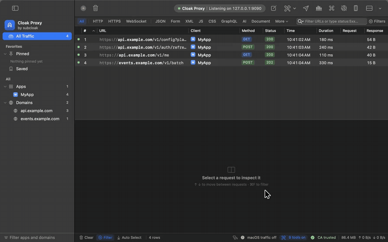
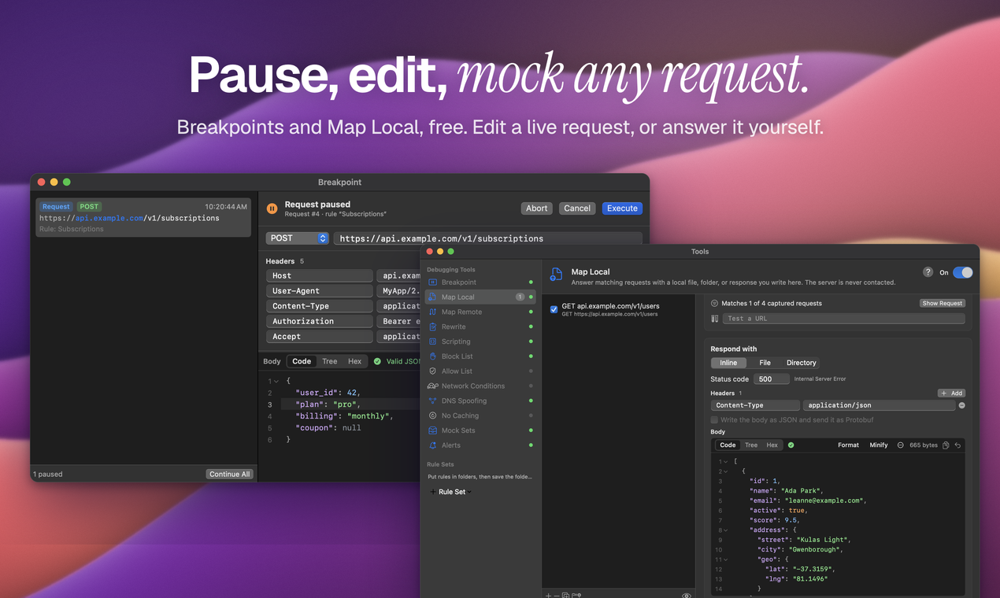
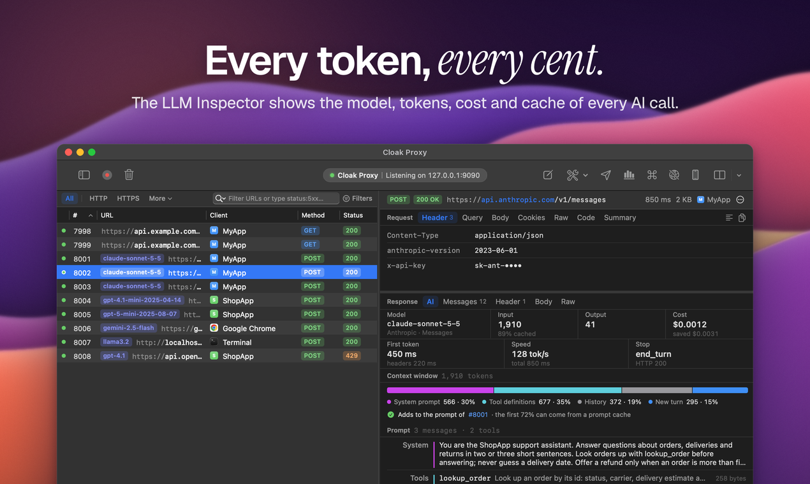
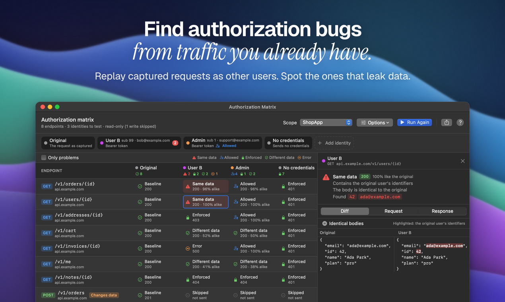
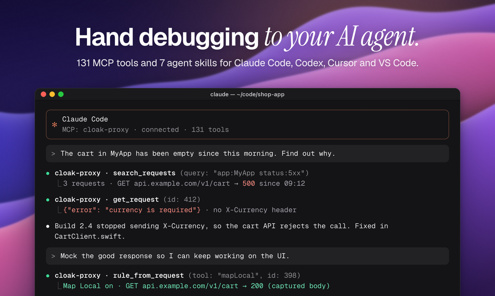

<h1 align="center">Cloak Proxy</h1>

See every request your Mac makes. A free, native macOS debugging proxy with an API client built in.

  <a href="https://subcloak.com/apps/cloak-proxy?utm_source=github">Download</a> ·
  <a href="https://docs.subcloak.com/cloak-proxy/">Docs</a> ·
  <a href="https://docs.subcloak.com/cloak-proxy/reference/release-notes/">Release notes</a> ·
  <a href="https://github.com/subcloak/cloak-proxy/issues">Report a bug</a>

Cloak Proxy decrypts HTTPS, lets you pause, mock and rewrite any request, catches apps that ignore the system proxy, and lets Claude or any MCP client drive it.

- **Free for life.** No trial, no paid tier, no account, no sign-up.
- **Native and universal.** Swift, for Apple silicon and Intel, macOS 14 Sonoma or later.
- **Local only.** No telemetry. Traffic, collections and the root certificate's key stay on your Mac.

## What it does

| | |
|---|---|
| **Capture** | HTTPS decryption by host or app, traffic grouped by app with icons, HTTP/2, WebSocket, gRPC and GraphQL, and App Capture, a network extension for apps that ignore the system proxy (Go and Rust tools, curl, many Electron apps) |
| **12 debugging tools** | Breakpoints, Map Local, Map Remote, Rewrite (no code), Scripting, Block List, Allow List, Network Conditions, DNS Spoofing, No Caching, Mock Sets and Alerts. Any rule can be limited to chosen apps |
| **Devices** | One-click iOS Simulator and Android setup, a certificate page with a QR code for iPhone, iPad and other devices, and Safari, Chrome and Firefox extensions that tag requests with their tab |
| **API client** | Collections, environments, tests, flows and monitors, stored as plain files you can keep in Git |
| **Inspect** | JSON tree, jq and JSONPath, Protobuf, request diffs, copy as cURL or 21 other languages, types from JSON |
| **Share** | HAR, Charles sessions, CSV, Postman collections and OpenAPI, with secret redaction |
| **AI and security** | LLM Inspector (tokens, cost, time to first token and prompt-cache misses for OpenAI, Anthropic, Gemini and Ollama) and an Authorization Matrix that replays traffic as another user to find IDOR bugs |
| **Automate** | An MCP server with 148 tools for Claude Code, Cursor and Codex, with secrets redacted, and `cloakctl` for headless runs in CI |

<table>
  <tr>
    <td></td>
    <td></td>
  </tr>
  <tr>
    <td></td>
    <td></td>
  </tr>
</table>

A one-minute tour: [youtu.be/ffpkFZRhO5g](https://youtu.be/ffpkFZRhO5g).

## Install

1. Download `Cloak-Proxy.dmg` from [subcloak.com/apps/cloak-proxy](https://subcloak.com/apps/cloak-proxy?utm_source=github) or from [Releases](https://github.com/subcloak/cloak-proxy/releases).
2. Optional: check the file with `shasum -a 256 ~/Downloads/Cloak-Proxy.dmg` and compare it with the SHA-256 on the download page or in the release notes.
3. Drag Cloak Proxy into Applications and open it. It's signed with a Developer ID and notarized by Apple, so it opens like any other app.

Step by step, with screenshots: [Install Cloak Proxy](https://docs.subcloak.com/cloak-proxy/getting-started/install/).

Or with Homebrew: `brew install --cask subcloak/tap/cloak-proxy`.

**Linux (beta):** a `.deb` for Debian and Ubuntu, an RPM for Fedora and RHEL 10, or an AppImage or portable `.tar.gz` for any distribution with WebKitGTK 6.0, on x86_64 and ARM64, from the same download page or [Releases](https://github.com/subcloak/cloak-proxy/releases). See [Install on Linux](https://docs.subcloak.com/cloak-proxy/getting-started/install-linux/).

## Why it's free, and why the source isn't public

Subcloak is a security testing company: we test web apps, APIs and AI agents for a living, and a debugging proxy is open on our screens all day. We built Cloak Proxy for our own work and give it away. Security testing pays for it, so there's no paid tier to upsell and no data to sell: the app has no account, no analytics, and update checks are off until you turn them on.

The app's source isn't public. The in-app SDK, [CloakProxyKit](https://github.com/subcloak/CloakProxyKit), is MIT. Releases are signed and notarized by Apple, and [SECURITY.md](SECURITY.md) explains how to report issues.

## This repository

This repository holds the issue tracker, release downloads and the changelog.

- **Bugs and feature requests:** [open an issue](https://github.com/subcloak/cloak-proxy/issues/new/choose). Please remove tokens, cookies and private hostnames from anything you paste.
- **Security issues:** don't open a public issue. See [SECURITY.md](SECURITY.md).
- **Questions:** the [docs](https://docs.subcloak.com/cloak-proxy/) cover every feature, and the [FAQ](https://docs.subcloak.com/cloak-proxy/reference/faq/) answers the common ones.

Built by [Subcloak](https://subcloak.com/?utm_source=github), an independent security practice for teams that ship.
